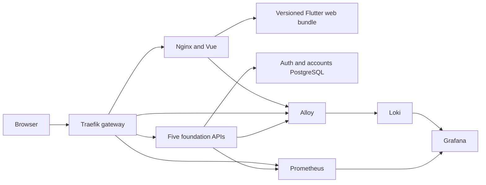

# Architecture

[Home](../README.md) · [Deployment](deployment.md) · [Observability](observability.md)

ASCII: browser -> Traefik -> Nginx/Vue + Flutter, or selected foundation API.
Auth/accounts -> their own PostgreSQL. Prometheus scrapes API/gateway/collector
metrics; Alloy receives bounded stdout logs and sends them to Loki. Grafana queries
Prometheus and Loki. No monitoring component controls application processes.

## Ownership

| Owner | Contract |
| --- | --- |
| baseRules / projectRules | Selected public norms; no endpoints, grants or runtime |
| pythonTemplate | Python packaging, quality and optional generated-project license |
| typerTemplate / fastApiTemplate | Native CLI / ASGI settings, instrumentation, logging and service chart |
| serviceTemplate | Pokerlost service identity, HTTP operations and SDK acquisition |
| pypokerlost | Public Python API, exact typed service IDs and TS/Dart generator |
| pokerGateway | Traefik HTTP selection, boundary validation and gateway chart |
| pokerWeb | Static Nginx, Vue lifecycle and website chart |
| pokerClient | Dart transport, shared Flutter UI and immutable web artifact |
| platformInfra | One artifact lock, environment values, composition, storage and observability |
| pokerengine | C++20 authority, Python binding and loopback console demo |
| Obsidian / Drive | Private knowledge/navigation / native collaborative documents |

HTTP uses one gateway origin and an operation path such as `/getOpenApi`.
`x-pokerlost-serviceId` is validated before a fixed named upstream is selected.
Values are exact and case sensitive; field names follow HTTP case insensitivity.
There is no service-prefix fallback or raw-header-derived URL. Known static paths
load without a service header; unknown API paths never fall back to HTML. Gateway
and backend preserve one validated `X-Request-ID`. Backend authorization still
owns bearer audience/scopes. Browser realtime is planned: a browser WebSocket
cannot set the custom HTTP header. See the [gateway contract](https://github.com/pokerlost/pokerGateway).

Only authService and accountsService have PostgreSQL and one-shot same-image
migration containers. Other foundations have no database settings. Historical
revisions remain intact. The local PostgreSQL chart is a disposable acceptance
fixture with retained PVCs, not a production database service.

`tools/environment.py` validates settings and writes data; `tools/artifacts.py`
validates artifact compatibility and owner packages. Neither launches commands.
Make invokes native Compose/Helm directly. Images, source commits, chart checksums,
SDK pins and the Flutter bridge are separate identities. SetupSystem remains the
source-checkout catalog owner; this repo does not add another inventory service.
